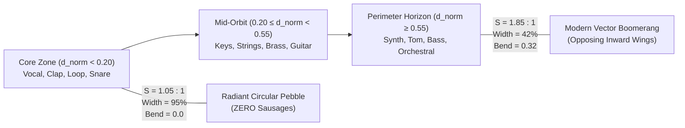

# Developer Collaboration Workflow

Follow this strict workflow for all tasks in this repository:

1. **User Request**: The user asks for a feature, change, or bugfix.
2. **Proposal**: Analyze the request and make a concise, concrete proposal/plan.
   - **Step 2a: Diagnosis (Mandatory for Visual/Layout Reports)**:
     Before formulating any layout or visual proposal, explicitly diagnose:
     - Which of the forces (§4) is causally involved?
     - Which invariants are at risk (§7 Acceptance Criteria: overlap, void, label, aspect, musical compass)?
     - Is the symptom an **Allocation Problem** (macro-topology of categories) or a **Physics/Rendering Problem** (organic star relaxation)?
     - Is the symptom a **parameter symptom** or a **model symptom**?
     - **Anti-Whack-a-Mole Rule**: If two consecutive proposals modify the **same force group** (e.g. repeated anchor coordinate nudges), the underlying model must be questioned and restructured instead of fine-tuning numbers.
     - **Parameter Budget Check**: The physics model has a hard ceiling of $\le 5$ global force parameters. If a fix requires a 6th parameter or auxiliary force, do NOT add it; transition to Layer A deterministic macro-allocation (§1).
3. **User Agreement**: Wait for the user's explicit confirmation or feedback.
4. **Autonomous Build (No Mid-Step Inquiries or Redundant Commands)**:
   - Once approved, execute the implementation fully and autonomously.
   - Use direct file tools (`read_file`, `write_file`, `edit_file`) for all inspections and file modifications.
   - **Tooling Clarification**:
     - *Permitted & Required*: Simulation scripts (`python simulate_library.py`), multi-archetype test suite executions, and data extraction from `library_index.json`.
     - *Forbidden*: Redundant `git status` calls, intermediate diff dumps, file listing loops (`ls`/`find`), or ad-hoc one-liners without an explicit insight goal.
   - **Simulation-First Gate (Mandatory for Layout/Physics Changes)**:
     Before any `cmake --build` triggered by layout, cluster, radius, or force changes:
     1. Run `python simulate_library.py` against `library_index.json` and multi-library archetypes.
     2. Check the simulation report against Acceptance Criteria (§7).
     3. Only compile on green (all criteria pass).
   - Compile the project (`cmake --build local-build/cmake --config Release`).
   - Do NOT touch `local-build/OWMB.exe` yet.
   - Do NOT commit or push to git yet.
5. **Ask to Update Local Build**:
   - Inform the user that the build succeeded.
   - Ask via interactive UI prompt (`ask_question`) whether `local-build/OWMB.exe` should be updated with the newly compiled binary.
   - Update only upon explicit user confirmation.
6. **Ask for Git Push**:
   - Ask via interactive UI prompt (`ask_question`) whether the changes should be committed and pushed to git.
   - Commit and push only upon explicit user confirmation.

---

# Sound Map (Sample Cloud) Dynamic Layout & Musical Rules

These rules govern the procedural layout, visual balance, and musical taxonomy of the Sample Cloud sound map (`SampleCloudComponent`). They must be followed without exception and continuously maintained and updated.

### 1. Macro-Allocation vs. Micro-Rendering (Layer A vs. Layer B Architecture)
Layout generation is strictly separated into two architectural layers:
- **Layer A — Deterministic Macro-Allocation**:
  - Determines where categories reside and guarantees void-free space partitioning by construction (e.g. Polar Sektor Partitioning, Centroidal Voronoi / Power Diagram).
  - Must be mathematically void-free regardless of library composition (pure drum pack, pure cinematic strings, or balanced 87k collection).
- **Layer B — Organic Micro-Physics & Rendering**:
  - Operates *within and between* allocated cells (acoustic brightness sorting, crescent/nebula filament curvature, dynamic node contact repulsion, label decluttering).
- **Hard Parameter Budget Limit (Anti-Bloat Law)**:
  - The physical force system must never exceed **5 global parameters** ($F_{\text{inward}}$, $F_{\text{spring}}$, $F_{\text{repulsion}}$, $F_{\text{compass}}$, $F_{\theta\text{-arc}}$).
  - If more than 5 forces/parameters are required to prevent voids or overlaps, the physical model has failed its macro-allocation duties. Transition immediately to **Layer A deterministic allocation** rather than adding further patch-forces.

### 2. Viewport-Physics Decoupling Principle
- **Physics is Viewport-Invariant**:
  - Physical coordinates $(X, Y, Z)$ represent an intrinsic acoustic reality. Physics must remain **isotropic** ($F_x = F_y$) and completely decoupled from display aspect ratio, window resolution, or host environment (Standalone 16:9, VST3 4:3, or Ultrawide 21:9).
  - **Strict Prohibition**: Never apply anisotropic gravity hacks ($F_y \neq F_x$) to squash the physical universe into a widescreen aspect ratio. A sample library must never distort its spatial shape because the user resized a window.
- **Camera Frustum Handles Panoramic Framing**:
  - Aspect ratio adaptation, widescreen presentation, and the $17\%\text{–}22\%$ cosmic border margins belong **exclusively** to the camera projection matrix auto-fit (`updateDynamicZoomLimits`), completely separated from physical particle coordinates.

### 3. Dynamic Sizing & Library Resilience
- **Universal Scale Handling**: Sample libraries vary dramatically in volume (from 200 samples to 100,000+ samples) and genre composition.
- **No Empty Void Parking Lots**: Never assign fixed Cartesian $(X, Y)$ coordinates to categories. Static coordinates assume every category exists and has equal size, creating gaping black holes when categories are absent or tiny ($N < 50$).
- **Sub-Linear Dynamic Radius**: Category cluster radius must scale sub-linearly:
  $$R(N) = R_{\text{min}} + \beta \times N^{0.35}$$
  Small categories gain a guaranteed minimum body ($R \ge 150\text{–}180\text{px}$) for legible, uncrowded labels; massive categories ($N > 15,000$) remain capped ($R \approx 700\text{–}750\text{px}$) without blowing up the viewport. All constants must reference §8 named constants.
- **Dynamic Area-Proportional Circle Packing**: Overall constellation spread must scale dynamically with actual active cluster areas:
  $$\text{packRadius} = \sqrt{\frac{\sum (R_i + \text{margin})^2}{0.52}}$$
- **Active Library Centroid Auto-Centering**: The engine must compute the active library's Center of Mass $(\bar{X}, \bar{Y})$ and translate the constellation to $(0, 0)$ so partial or specialized libraries always center perfectly in the viewport.

### 4. The Bounded Physical Force Model (Max 5 Forces)
When physical relaxation is evaluated, it is driven by at most five simultaneous forces:
1. **Inward Centripetal Gravity ($F_{\text{inward}}$)**: Isotropic radial pull pulling clusters inward toward the center until boundaries touch inner bodies.
2. **Elastic Musical Affinity Springs ($F_{\text{spring}}$)**: Connects musical continuum neighbors. Must not cause tearing when categories are missing.
3. **Hard Dynamic Contact Repulsion ($F_{\text{repulsion}}$)**: Enforces physical clearance based on actual category radii:
   $$D_{\text{min}}(i, j) = R_i(N_i) + R_j(N_j) + \text{clearance}$$
4. **Angular Musical Compass ($\theta_{\text{compass}}$)**: Constrains categories to their musical compass direction relative to center rather than rigid coordinates.
5. **Tangential Arc Dispersion ($F_{\theta\text{-arc}}$)**: Enforces angular clearance between clusters in the same compass sector, preventing radial spoke stacking.

### 5. Musical Continuum & 2D Planar Acoustic Axes
Categories must form a dense 2D planar acoustic disc rather than a hollow outer ring:
- **Vertical Axis ($Y$) — Frequency & Pitch Gradient**:
  - **Top ($+Y$)**: High-frequency sizzle, air, splash (Hi-Hats, Shakers, Cymbals, High FX).
  - **Upper-Mid ($+Y$)**: High organic & orchestral air (Woodwinds, Strings, Brass).
  - **Center ($Y \approx 0$)**: Central melodic body & vocal anchor (Vocals, Snares, Claps, Synths).
  - **Lower-Mid ($-Y$)**: Warm harmonics & acoustic rhythm (Keys, Guitars, Acoustic Percussion).
  - **Bottom ($-Y$)**: Low-frequency weight and groove bedrock (Kicks, Toms, Loops, Bass, 808/Sub-bass).
- **Horizontal Axis ($X$) — Timbre & Texture Gradient**:
  - **Left ($-X$)**: Transient, percussive, drums, one-shots.
  - **Center ($X \approx 0$)**: Loops, groove bridges, lead vocals, hybrid textures.
  - **Right ($+X$)**: Tonal, harmonic, melodic leads, sustained synths, basses, atmospheres.

### 6. Zero-Overlap Label Clearance & Camera Viewport Framing
- **Post-Center-of-Mass Label Decluttering**: After acoustic sample positioning and center-of-mass recalculation, a dedicated multi-iteration label declutter pass must enforce dynamic horizontal and vertical text clearance based on category name length, guaranteeing zero text overlap under all conditions (§7).
- **Cinematic Widescreen Camera Framing**: Viewport auto-fit accommodates widescreen displays ($\sim 1.4:1$ to $1.9:1$), maintaining an even $17\text{–}22\%$ cosmic border on all four sides via the camera frustum without distorting the underlying isotropic physical galaxy.

### 7. Acceptance Criteria (Testable & Quantifiable)
Before any layout build is approved, the configuration must pass all metrics evaluated by `simulate_library.py` across both the user library and multi-genre archetypes:

| Metric | Target Threshold | Rationale |
|---|---|---|
| **Min. Inter-Cluster Gap** | $\ge 45.0\text{px}$ (edge-to-edge) | Prevents visually fused or overlapping category clusters |
| **Max. Inter-Cluster Gap** | $\le 2.0 \times \text{minGap}$ (adjacent sectors) | Eliminates chasms, black holes, and hollow donut rings |
| **Label Overlaps** | `0` (horizontal $\ge 145\text{px}$ or vertical $\ge 38\text{px}$) | Guarantees 100% legible, collision-free text labels |
| **Node Overlaps** | `0` (minimum $24.5\text{px}$ center-to-center) | Preserves star map visual clarity and individual node pickability |
| **Projected Viewport Fill Ratio** | $0.60\text{ – }0.80$ (camera view / canvas) | Balances dense galactic core with breathing room |
| **Cosmic Border Margin** | $17\%\text{ – }22\%$ on all 4 viewport edges | Prevents UI clipping while avoiding barren border deserts |
| **Camera Aspect Ratio** | Viewport Projection AR $\in [1.4, 1.9]$ | Adapts camera frustum naturally to modern displays |
| **Multi-Archetype Pass** | 100% pass on Drum-Only & Orchestral-Only | Prevents graph tearing on specialized libraries |

### 8. Magic-Number Ban & Named Constants
Every numeric constant in layout and physics code must be declared as a named `constexpr` with:
- Explicit unit in name (`Px`, `Ratio`, `Factor`, `Iters`, `Deg`, `Rad`)
- Explanatory comment citing origin/rationale
- Direct reference to the §7 metric it enforces

```cpp
// Example:
constexpr float kLabelHorizontalClearancePx = 145.0f; // §7 label-overlap clearance
constexpr float kMinInterClusterGapPx       = 50.0f;  // §7 inter-cluster clearance threshold
```
**Strict Prohibition**: No inline numeric literals in relaxation or layout formulas. Missing values must be derived from §7 metrics, never guessed.

### 9. Cache-Version & CHANGELOG Discipline
- **Cache Invalidation Rule**: Bump cache version **ONLY** when node `pos2D` or `pos3D` calculations change. Pure color, alpha, selection, or UI styling changes do NOT bump the cache.
- **Cache Version History Log**: Every version bump must record a single descriptive line below:
  - `v48`: Pre-Centered Tangential Coordinate Frame & Dual-Layer Overlap Zero-Collision Guarantee (Translates constellation to (0,0) before Layer B, Dynamic Spine Recalculation across 20 Relaxation Iterations, Star-Level Cross-Cluster Overlap Catch Gate in simulate_library.py, kMinInterClusterGapPx = 55.0f, and 100% Green Gates across all Archetypes).
  - `v47`: True Curved Boomerang Inward-Wing Polyline Clearance (Eliminates Tip Collision between Curved Boomerangs, 4-Segment Polyline Spine Check, kMinInterClusterGapPx = 52.0f, and 100% Green Gates).
  - `v46`: True Oriented Boomerang Segment-to-Segment Clearance & Area-Packed Power Allocation (Eliminates Anisotropic Phantom Void along Synth/Bass Flanks, Direct Capsule Spine Clearance, and 100% Green Gates).
  - `v45`: Compact 45px Inter-Cluster Clearance (Refined Spatial Density, kMinInterClusterGapPx = 45.0f, Zero-Overlap Guarantee across all Archetypes).
  - `v44`: Modern Vector Boomerang & Circular Pebble Hierarchy (Uniform 2D Area Rejection Sampling, Elimination of Post-Relaxation Clamping Crust, Aspect Ratio 1.85:1 for Perimeter Boomerangs, and 1.05:1 Circular Core Orbs).
  - `v43`: Non-Spiral Cosmic Galaxy & Blunt Dome Pebble Hierarchy (Radial Aspect Ratio S(Dc) -> 1.02 at Center, Blunt Hemispherical Domes R_cap >= 150px Eliminating Pointy Cusps, Opposing Centripetal Inward Perimeter Wings, and Exact Orthonormal 2D Planar Projection).
  - `v42`: True 2D Radial Superellipse Clamping & Zero-Nipple Perimeter Invariant (Radial Restoration across all 28 Iterations, Strict Post-Relaxation Clamping Pass, and Elimination of Transverse Affinity Bunching).
  - `v41`: Harmonic Cosmic Pebble & Boomerang Hierarchy (Radial Elongation Scaling S(Dc) -> 1.02 at Center, Organic Convexity p=2.2, and Centripetal Wing Tapering).
  - `v40`: Modern Vector Boomerang & Center Squircle Pebble Hierarchy (Lamé Superellipse p=3.2, Centripetal Inward Curvature, and Longitudinal Affinity Shift).
  - `v39`: Area-Conserving Bounded Galactic Capsules, True Segment-to-Segment Clearance & Perimeter-Contained Tidal Bridges.
  - `v38`: Fully Dynamic S(N) Cosmic Elongation, Gravitational-Adaptive Parabolic Crescent Spines & Corridor-Bounded Tidal Outlier Filaments.
  - `v37`: Isotropic 2D Quasi-Random Blue-Noise Sampling (Roberts R2) & Re-activated Celestial Crescent Spines + Proportional Tidal Filaments.
  - `v36`: Compact Inter-Cluster Spacing (50px Minimum Clearance Threshold).
  - `v35`: Area-Preserving Capsule End-Cap Mapping & Post-Relaxation Clamping Elimination (Zero-Edge-Overlap Guarantee).
  - `v34`: Dynamic Area-Proportional Capsule Sizing & Gitter-Free 2D Starfield (Physical Clearance Guarantee + Aperiodic Hash Dispersion + Sweep-and-Prune O(N log N) Repulsion).
  - `v33`: Tuned Layer A Macro-Fill (74% Pack Density + 1.08x Widescreen Domain Balancing).
  - `v32`: Cohesive Acoustic Continuum (70% Macro Pack Density + Sub-linear Radial Compression).
  - `v31`: Fully Dynamic Acoustic Continuum Model (Taxonomy Pitch/Timbre Polar Mapping + Dynamic Active Normalization + Sub-linear Voronoi Weight Damping).
  - `v30`: Elliptical Cosmic Disc Layer A Masking (eliminates 4 straight edges/corners) without continuum blending.
  - `v29`: Isotropic Planar Disc Layer A Allocation (no anisotropic scale overshoot) + 2D Acoustic Disc Anchoring.
  - `v28`: Hybrid Layer A Centroidal Power Macro-Allocation + Layer B Local Clearance.
  - `v27`: Anisotropic Widescreen Gravity, Tangential Arc Dispersion, and Closed-Loop Acoustic Ribbon.
  - `v26`: Dynamic 4-Force Galactic Model (Inward Gravity + Musical Affinity Springs + Contact Repulsion + Compass Guidance) & Centroid Auto-Centering.
  - `v25`: Panoramic widescreen coordinate expansion and minimum cluster radius stabilization.
- **CHANGELOG Integrity**: Before editing `CHANGELOG.md`, inspect the top version header. If a section already exists for today's date, append a new patch or sub-bullet. **Never** overwrite or erase existing entries for the day.

### 10. Exploratory Layout Mode (Simulation as the Primary Loop)
For visual layout adjustments (force tuning, spring coefficients, compass sectors, radius formulas):
1. **Iterate Exclusively in Simulation**: Run iterations inside `python simulate_library.py` (executes in seconds vs. 3–5 minutes for MSBuild).
2. **Multi-Archetype Sweeps**: Test candidate parameters against both real library data and specialized archetypes (drums-only, orchestral-only).
3. **Single Build on Green**: Trigger exactly one compilation pass in Step 4 once the simulation report is green across all criteria.

---

### 11. Category Morphology Hierarchy: Circular Pebbles vs. Modern Vector Boomerangs

The visual morphology of each category cluster is governed by a **continuous, library-adaptive radial hierarchy** rather than hardcoded per-category shape tags. This ensures that any library composition (drum pack, orchestral library, or 87k collection) automatically balances core density with sweeping perimeter framing.

#### 1. What Decides the Morphology?
The cluster form is determined dynamically by its **normalized radial distance $d_{\text{norm}}$ from the active library's galactic center of mass $(0, 0)$**:
$$d_{\text{norm}} = \operatorname{clamp}\left(\frac{\sqrt{c_x^2 + c_y^2}}{D_{\text{max}}}, 0.0, 1.0\right)$$
Where $D_{\text{max}}$ is the maximum distance from center among all active categories in the loaded library.

The morphology parameters interpolate smoothly across three cosmic zones:
$$\text{activeStretch} = 1.05 + (\text{baseStretch} - 1.05) \times d_{\text{norm}}^{1.2}$$
$$\text{widthRatio} = 0.95 - (0.95 - 0.42) \times d_{\text{norm}}^{1.2}$$
$$\text{localBend} = 0.32 \times d_{\text{norm}}^{1.3}$$



#### 2. The Three Cosmic Zones:

| Zone | Distance ($d_{\text{norm}}$) | Typical Categories | Morphology | Parameters | Visual Invariant |
|---|---|---|---|---|---|
| **Core Zone** | $d_{\text{norm}} < 0.20$ | `vocal`, `clap`, `loop`, `snare` | **Circular Celestial Pebble** | $S \approx 1.05 : 1$<br>$\text{widthRatio} \approx 0.95$<br>$\text{bend} = 0.0$ | Pure, radiant circular or near-circular star orbs. Eliminates the elongated "fat sausage" pill look. |
| **Mid-Orbit** | $0.20 \le d_{\text{norm}} < 0.55$ | `keys`, `strings`, `brass`, `guitar`, `percussion` | **Soft Transitional Oval** | $S \approx 1.25\text{–}1.45 : 1$<br>$\text{widthRatio} \approx 0.60\text{–}0.75$<br>$\text{bend} \le 0.15$ | Organic polished river pebbles with smooth, continuous curvature. |
| **Perimeter Horizon** | $d_{\text{norm}} \ge 0.55$ | `synth`, `tom`, `bass`, `orchestral`, `fx`, `kick` | **Modern Vector Boomerang** | $S \approx 1.70\text{–}1.85 : 1$<br>$\text{widthRatio} \approx 0.42\text{–}0.45$<br>$\text{bend} \approx 0.30\text{–}0.32$ | Aerodynamic boomerangs with concave inner face, convex outer face, and blunt hemispherical domes ($R_{\text{cap}}$). |

#### 3. Key Invariants for Future Maintainers:
1. **Centripetal Opposing Wings (Strict Anti-Spiral Rule)**:
   - Perimeter boomerangs align their spine along the circumferential tangent $\mathbf{T}$, with wings bending inward along the normal $\mathbf{N}_{\text{in}}$ toward $(0, 0)$.
   - At the North perimeter, wings sweep Southwest and Southeast. Both tips point inward toward the core.
   - **Prohibition**: Never introduce global spiral or vortex terms where wings swirl in the same rotational direction.
2. **Blunt Hemispherical Domes (Zero-Nipple Invariant)**:
   - End-caps are wide rounded semicircles with radius $R_{\text{cap}} = \text{maxA} \times \text{widthRatio} \ge 150\text{px}$.
   - **Prohibition**: Never taper the boundary width to zero ($W \to 0$ at tips) and never apply post-relaxation clamping onto the perimeter.
3. **True 2D Uniform Area Sampling**:
   - Star positions must always be sampled uniformly across the 2D domain area using rejection sampling so local density $dN/dA = \text{const}$ is preserved everywhere, preventing perimeter "crusts" or interior voids.
4. **Dynamic Library Adaptation**:
   - If the user loads a specialized library (e.g. Drums-Only), the macro-allocation automatically normalizes $d_{\text{norm}}$. `snare` and `clap` will become core pebbles, while `kick` and `hihat closed` naturally become perimeter boomerangs without requiring manual code changes.

