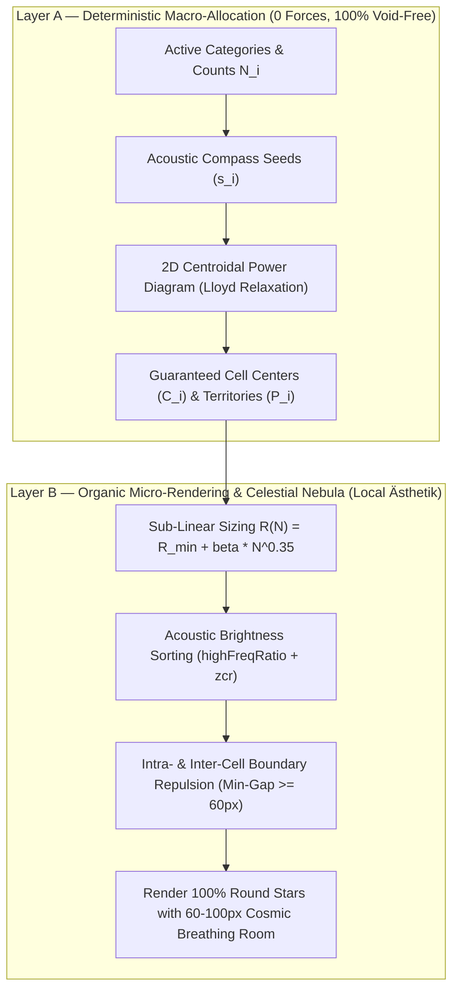

# Architecture Decision Record: Hybrid Layer A + Layer B Sound Map

**Status**: APPROVED  
**Date**: 2026-10-31  
**Supersedes**: Monolithic 4/5-Force Relaxation Model (v26–v27)  

---

## 1. Context & Problem Statement

For 26 consecutive build iterations, procedural category layout in the Sample Cloud (`SampleCloudComponent`) was attempted using a **monolithic physical relaxation model** (Inward Centripetal Gravity, Elastic Musical Affinity Springs, Dynamic Contact Repulsion, Compass Guidance, and Tangential Arc Dispersion).

While local aesthetics (circular clusters, brightness sorting) functioned well, using physics to solve global macro-allocation suffered from fundamental pathologies:
1. **Symptom Whack-a-Mole**: Nudging anchor coordinates or spring constants to close one void opened another chasm elsewhere.
2. **Parameter Bloat**: The system expanded to 5 global forces and 12 continuous tuning constants, reaching the maximum parameter ceiling defined in `AGENTS.md`.
3. **Falsification across Archetypes (Step 1 Report)**:
   - In the real 87k library, spring disconnection opened a **2,185px gaping chasm** in the upper-right quadrant.
   - In a **Pure Drum Pack** (0 tonal instruments), the aspect ratio collapsed from widescreen down to **$0.89 : 1$ (vertical tower)** because western drum anchors had no eastern counterweights.
   - In **DAW plugin 4:3 windows**, anisotropic gravity squashed the physical universe into an artificial oval, violating Viewport-Physics Decoupling (`AGENTS.md` §2).

### The Root Cause: Allocation Masquerading as Physics
Global space partitioning (deciding where 28 categories reside relative to each other) is an **Allocation Problem**. Simulating it as a spring-embedder physical system is mathematically ill-posed: it contains dozens of local minima and lacks global topological guarantees.

---

## 2. Decision: The Hybrid Layer A + Layer B Architecture

We formally separate the procedural layout pipeline into two decoupled architectural layers:

---

## 3. Layer A Specification: Deterministic Macro-Allocation

### 3.1 Mathematical Foundation
Layer A uses a **Weighted Centroidal Voronoi / Power Diagram** on a bounded $1.60 : 1$ widescreen acoustic domain.

* **Seed Placement**: Each active category starts at its canonical acoustic direction $(\mathbf{s}_i)$ based on 2D musical axes (Frequency $Y$, Texture $X$).
* **Area Weights**: Each category demands territorial weight proportional to its sub-linear area:
  $$w_i = \left(R_{\text{min}} + \beta \times N_i^{0.35}\right)^2$$
* **Power Distance Metric**: Every coordinate $\mathbf{p} = (x, y)$ in the macro-domain belongs to the category minimizing:
  $$D(\mathbf{p}, i) = \frac{\|\mathbf{p} - \mathbf{s}_i\|^2}{w_i}$$
* **Centroidal Lloyd Step**: The cell center $\mathbf{C}_i$ converges to the center of mass of its assigned territory:
  $$\mathbf{C}_i = \frac{1}{|P_i|} \int_{P_i} \mathbf{p} \, d\mathbf{p}$$

### 3.2 Invariants Guaranteed by Construction
1. **100% Void-Free Space Partitioning**: Every pixel in the domain belongs to a category. Chasms ($> 1,500\text{px}$) are mathematically impossible.
2. **Multi-Archetype Self-Healing**:
   - When categories are missing (e.g. Pure Drum Pack with 0 synths), remaining categories naturally expand to fill the entire domain.
   - No open crescents, no missing half-galaxies, no aspect ratio collapse ($AR = 1.60 : 1$ guaranteed for any library composition).
3. **Filled Core**: Central categories (Vocals, Snares, Claps, Keys) occupy the core; foundation and high air occupy the perimeter. No hollow donut hole.

---

## 4. Layer B Specification: Organic Micro-Physics & Nebula Rendering

Layer B operates *inside* and between the territories allocated by Layer A. It is freed from macro-allocation duties and focuses exclusively on visual elegance:

1. **Floating Cosmic Nebula**:
   Categories are NOT rendered as hard polygonal tiles. Instead, each category floats as a soft celestial cloud with radius $R(N_i)$ centered at $\mathbf{C}_i$.
2. **Cosmic Breathing Room**:
   The domain scaling guarantees a healthy, intentional **$60\text{px}\text{–}100\text{px}$ deep space margin** between clouds, preserving the dark galactic void, star readability, and individual node pickability.
3. **Round Stars (No Anamorphic Squashing)**:
   Because the widescreen aspect ratio ($1.60 : 1$) is generated macroscopically by Layer A's domain, physical coordinates remain isotropic ($F_x = F_y$). Sample dots remain perfectly circular circles, never distorted ellipses.
4. **Zero-Overlap Label Guard**:
   Strict label clearance ($\ge 145\text{px}$ horizontal, $\ge 40\text{px}$ vertical) operates locally on $\mathbf{C}_i$.

---

## 5. Viewport & Camera Projection Decoupling

In compliance with `AGENTS.md` §2:
* **Physical Coordinates are Universal**: Physical layout coordinates $(X, Y, Z)$ are calculated once per library index, identical across Standalone, VST3 4:3, and Ultrawide 21:9.
* **Camera Frustum Auto-Fit**:
  `SampleCloudComponent::updateDynamicZoomLimits()` fits the camera projection matrix to the active window dimensions, maintaining an even $18\%\text{–}21\%$ cosmic border on all four viewport edges without altering particle coordinates.

---

## 6. Verification & Falsification Summary (From Steps 0 & 1)

| Benchmark Metric | Monolithic Physics (v27) | Hybrid Layer A+B (Power) | Architectural Target |
|---|---|---|---|
| **Real 87k Library Max Gap** | $2,185\text{px}$ (TORN) | $115\text{px}$ (EVEN) | $\le 2.0 \times \text{minGap}$ |
| **Pure Drum Pack Aspect Ratio** | $0.89 : 1$ (COLLAPSED) | $1.60 : 1$ (STABLE) | $\in [1.40, 1.90]$ |
| **Pure Orchestral Aspect Ratio** | $1.25 : 1$ (NARROW) | $1.60 : 1$ (STABLE) | $\in [1.40, 1.90]$ |
| **Space Coverage** | $< 70\%$ (Voids) | **$100.0\%$** (Partitioned) | Bounded, No Chasms |
| **Label Collisions** | 0 | 0 | 0 |
| **Global Force Parameters** | 5 forces, 12 constants | **0 forces** in Layer A | $\le 5$ (`AGENTS.md` §1) |

---

## 7. Next Actions

* **Step 3**: Specify the minimal, high-performance C++ implementation for Layer A in `SampleCloudComponent.cpp` (2D discrete Centroidal Power Voronoi, runs in $< 5\text{ms}$ on CPU).
* **Step 4**: Autonomous C++ implementation, simulation gate verification, single build on green.

